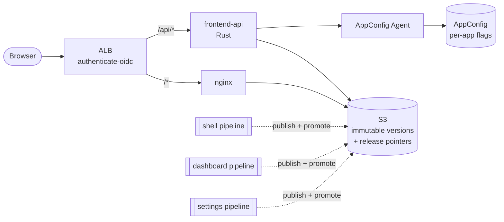

# GovCloud MFE

A proof of concept for an **AWS GovCloud-native micro-frontend platform**. It is meant to be
read rather than deployed. It shows how to:

- compose a React **shell** and independently built **remote modules** with
  **Module Federation 2.0** (Rsbuild/Rspack),
- authenticate **every** request, including JS and CSS, with an **ALB `authenticate-oidc`**
  action, because GovCloud has no CloudFront,
- serve assets through **nginx from a private S3 bucket**,
- run a small **Rust same-origin API** for frontend-only concerns (identity, module registry,
  feature flags, preferences, telemetry),
- give **each module its own pipeline**, so it deploys and **rolls back on its own**,
- use **AWS AppConfig** feature flags, with one AppConfig application per module,
- share server state across modules with **TanStack Query**,
- define all of it with **AWS CDK**.



## How it fits together

1. **Build once.** Each app is built against the path its files will be served from,
   `/apps/<app>/<version>/`, and uploaded there once. Nothing under a version prefix ever changes.
2. **Release with a pointer.** Making a version live means one S3 write: `releases/<app>.json`
   for a remote, `index.html` for the shell. Rolling back writes the previous value. No rebuild,
   no cache invalidation, and other modules aren't affected.
3. **Discover at runtime.** The shell has no build-time remotes. It asks `/api/modules` what's
   live (minus any module whose AppConfig kill switch is off) and loads each remote's
   `mf-manifest.json` through the Module Federation runtime.
4. **Roll back automatically.** The shell reports remote load and render failures. The API
   turns them into a per-module CloudWatch metric, and each module's alarm gates its pipeline's
   prod stage (CodePipeline stage rollback) and its AppConfig flag deployments.

Read [docs/architecture.md](docs/architecture.md) for the full picture,
[docs/contracts.md](docs/contracts.md) for the interfaces between independently deployed parts,
and [docs/adr](docs/adr) for the reasoning behind each decision.

## Repository layout

| Path                     | What                                                                    |
| ------------------------ | ----------------------------------------------------------------------- |
| `apps/shell`             | Host app: layout, navigation, runtime remote loading, error isolation  |
| `apps/dashboard`         | Remote: TanStack Query polling, a multi-variant feature flag           |
| `apps/settings`          | Remote: preferences with an optimistic mutation, flag inspector         |
| `packages/contracts`     | Types shared across deployables (release record, API DTOs, descriptor)  |
| `packages/platform-sdk`  | Runtime SDK: `apiFetch`, `platformQueries`, `useFeatureFlag`, telemetry |
| `packages/mf-config`     | Build-time Module Federation "golden path" every app uses               |
| `packages/ui`            | Design tokens and a few components                                      |
| `services/edge-nginx`    | Authenticated static origin: nginx → S3 via a VPC gateway endpoint      |
| `services/frontend-api`  | Rust (axum) same-origin API                                             |
| `tools/release`          | `release deploy / rollback / status` CLI used by pipelines and humans   |
| `infra`                  | CDK: platform stack, per-app stacks, per-app pipelines                  |
| `docs`                   | Architecture, contracts, ADRs, runbook, GovCloud notes                  |

Each app is described by `apps/<app>/microfrontend.json`. The build, the CDK app and the release
CLI all read it, so adding a module means adding a folder.

## Running locally

Prerequisites: Node 24+, pnpm 12 (`corepack enable`), and a Rust stable toolchain.

```sh
pnpm install
pnpm dev
```

This starts the shell on <http://localhost:3000>, the remotes on :3001 and :3002, and the
frontend API on :8080 with `APP_ENV=local`. Locally the API:

- signs you in as a fixed development user (it refuses to do this unless `APP_ENV=local`),
- reads release records from [`dev/releases`](dev/releases), which point at the remotes' dev
  servers,
- reads flags straight from each app's `feature-flags.json`.

A remote can also be developed on its own: `pnpm --filter @govcloud-mfe/dashboard dev` and open
<http://localhost:3001>.

## Checks

```sh
pnpm lint         # Biome
pnpm typecheck    # TypeScript, every package
pnpm test         # Vitest (SDK, mf-config, release CLI, CDK assertions) + cargo test
pnpm build        # production builds (set RELEASE_VERSION to mimic CI)
pnpm --filter @govcloud-mfe/infra synth
```

## Deploying and rolling back

See the [runbook](docs/runbooks/deploy-and-rollback.md). In short: every app's pipeline builds once,
deploys to dev, waits for approval, deploys to prod and bakes against the app's alarm, rolling
back automatically on failure. For break-glass, run
`pnpm release rollback --app <app> --stage prod`.

GovCloud-specific gotchas (ALB key endpoints, CodeConnections region, image mirroring, FIPS)
are collected in [docs/govcloud.md](docs/govcloud.md).

## What's deliberately out of scope

- Domain APIs. The frontend API only covers frontend concerns ([ADR 0006](docs/adr/0006-rust-frontend-api.md)).
- Durable preferences storage (in-memory here, DynamoDB in production).
- Retention of old versions (keep the last N per app, never the live one).
- A self-mutating platform pipeline. The platform and pipeline stacks are deployed with `cdk deploy`.
