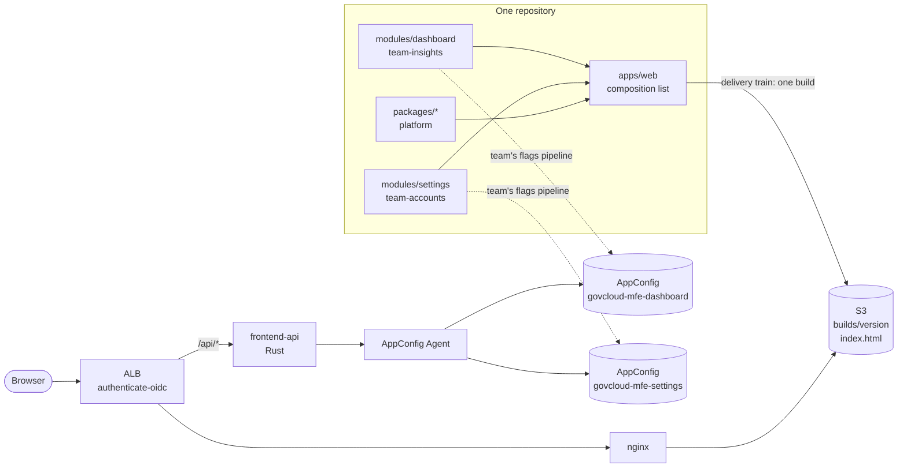

# GovCloud MFE: build-time composition

> **Branch `build-time-composition`.** This is the same product, platform and team structure as
> `main`, but modules are composed when the app is **built** instead of at runtime with Module
> Federation. Read [the comparison](docs/comparison-with-module-federation.md) first.

A proof of concept for an **AWS GovCloud-native frontend where different teams own different
modules, compiled into one application**. It is meant to be read rather than deployed. It shows
how to:

- give each team a module it owns (`modules/<name>/`), with ownership **enforced** by
  CODEOWNERS, Turborepo boundaries, package exports and an ownership check,
- compose those modules into one React app at build time, each lazily loaded in its own chunk,
  with the compiler checking every contract between teams,
- authenticate **every** request, including JS and CSS, with an **ALB `authenticate-oidc`**
  action, since GovCloud has no CloudFront,
- serve the build through **nginx from a private S3 bucket**,
- run a small **Rust same-origin API** for identity, feature flags, preferences and telemetry,
- give each team **its own pipelines**: a PR gate that builds the composed app, and a flags
  pipeline that releases features on the team's own schedule,
- ship code on one **delivery train** that bakes against every module's alarm and rolls back on
  its own,
- use **AWS AppConfig** feature flags (one application per module) as each team's release and
  rollback lever, with typed flag hooks,
- share server state with **TanStack Query**,
- define all of it with **AWS CDK**.



## How it fits together

1. **Teams own modules, and the repo enforces it.** A module is a package exporting
   `defineModule({ name, route, owner, component: lazy(...) })`. It may only depend on platform
   packages. Changes to it need its team's review.
2. **The app composes at build time.** `apps/web/src/modules.ts` lists the modules. The build
   compiles everything into one bundle, gives each module its own chunk, and records a content
   revision per module in `composition.json`.
3. **One train ships code.** Every merge builds once and goes dev → approval → prod. The prod bake
   watches every module's alarm, and the pipeline rolls the release back if any of them fires,
   naming the module and team.
4. **Teams release with flags.** Code ships dark. Each team turns features (and, if needed, its
   whole module) on and off through its own AppConfig application, deployed by its own pipeline.
   AppConfig reverts a flag rollout automatically if the module's alarm fires.

Read [docs/architecture.md](docs/architecture.md) for the full picture,
[docs/contracts.md](docs/contracts.md) for the interfaces the compiler can't check, and
[docs/adr](docs/adr) for the reasoning behind each decision.

## Repository layout

| Path                     | Owner          | What                                                          |
| ------------------------ | -------------- | ------------------------------------------------------------- |
| `apps/web`               | team-platform  | The app: layout, routing, composition list, module isolation  |
| `modules/dashboard`      | team-insights  | Module: TanStack Query polling, a multi-variant feature flag  |
| `modules/settings`       | team-accounts  | Module: preferences with an optimistic mutation, flag inspector |
| `packages/contracts`     | team-platform  | Types shared with tooling and infra (descriptor, release record, API) |
| `packages/platform-sdk`  | team-platform  | `defineModule`, `createModuleFlags`, `platformQueries`, telemetry, `/testing` |
| `packages/ui`            | team-platform  | Design tokens and a few components                            |
| `services/edge-nginx`    | team-platform  | Authenticated static origin: nginx → S3 via a VPC gateway endpoint |
| `services/frontend-api`  | team-platform  | Rust (axum) same-origin API                                   |
| `tools/release`          | team-platform  | `release deploy / rollback / status` CLI                      |
| `tools/ownership`        | team-platform  | Checks that CODEOWNERS, `module.json` and the composition agree |
| `infra`                  | team-platform  | CDK: platform, web and module stacks; delivery, checks and flags pipelines |

## Running locally

Prerequisites: Node 24+, pnpm 12 (`corepack enable`), and a Rust stable toolchain.

```sh
pnpm install
pnpm dev
```

This starts the app on <http://localhost:3000> and the frontend API on :8080 with
`APP_ENV=local`. Locally the API signs you in as a fixed development user (it refuses to unless
`APP_ENV=local`) and reads flags straight from each `feature-flags.json`. There is one dev server
for everything. Module teams test in isolation with `renderWithPlatform` from
`@govcloud-mfe/platform-sdk/testing`.

## Checks

```sh
pnpm lint         # Biome + turbo boundaries + ownership check
pnpm typecheck    # TypeScript, every package
pnpm test         # Vitest (modules, SDK, app, release CLI, CDK assertions) + cargo test
pnpm build        # production build (set RELEASE_VERSION to mimic CI)
pnpm --filter @govcloud-mfe/infra synth
```

## Shipping and rolling back

See the [runbook](docs/runbooks/deploy-and-rollback.md). In short: the fastest fix for one team's
problem is its own flag or kill switch (seconds, and automatic on alarm). The fastest fix for a
broken release is a whole-app rollback (seconds). Taking back one team's code while keeping
everyone else's is a `git revert` that the train ships.

GovCloud-specific notes, including why there's no package registry (CodeArtifact isn't available
in GovCloud), are in [docs/govcloud.md](docs/govcloud.md).
