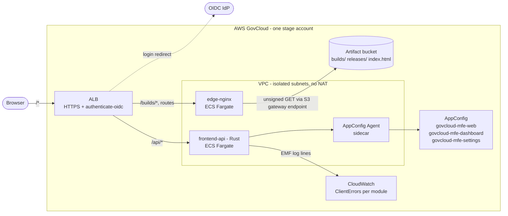
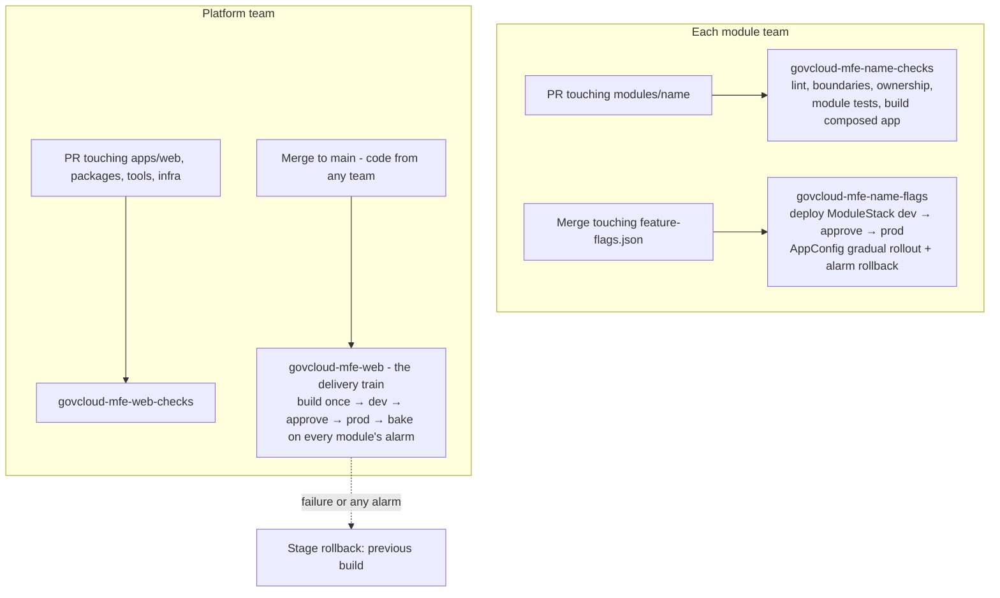

# Architecture: build-time composition

> This is the **build-time** variant. The `main` branch composes the same modules at runtime with
> Module Federation. [comparison-with-module-federation.md](comparison-with-module-federation.md)
> covers what changes between the two, and why.

## Goals and constraints

- **GovCloud native.** There's no CloudFront, so the static origin is nginx on ECS Fargate behind
  an Application Load Balancer.
- **Every request is authenticated**, including JS and CSS, by the ALB's `authenticate-oidc`
  action.
- **Teams own modules.** Each team owns its code, its feature flags, its quality gate and its
  alarm, and other teams can't change or break those without the owner's review.
- **Modules are composed at build time.** There's one build and one deployable. Modules are
  ordinary packages compiled into the app.

## The core trade

Composing at build time means **one deployable**. So the question is no longer "how does a
module deploy itself", but "how much autonomy can a team keep when everyone ships together".
This design keeps:

| Team capability            | How it's kept                                                             |
| -------------------------- | ------------------------------------------------------------------------- |
| Own the code               | `modules/<name>/` is the team's, enforced by CODEOWNERS, `turbo boundaries` and the ownership check |
| Own the quality gate       | A per-module PR checks pipeline that runs the module's tests **and** builds the composed app |
| Own the release decision   | The module's own AppConfig application, deployed by the module's own flags pipeline. Code ships dark; the team turns it on |
| Roll back its own change   | In seconds, turn the flag or kill switch off (automatic when the module's alarm fires). In minutes, revert the commit; the train ships it |
| Know its blast radius      | Every release records each module's content revision, so rollbacks name the teams whose code they undo |

And gives up:

- **Independent deploys.** Every merge to `main` ships every module's current code. Teams merge
  small, flag-gated changes (trunk-based development) instead of deploying on their own
  schedule.
- **Per-module code rollback by pointer swap.** Undoing a single module's code means a revert
  commit plus a pipeline run (minutes). The seconds-fast pointer swap rolls back the whole app.

In exchange:

- The compiler checks every contract between modules and the platform on every PR.
- There's one copy of every dependency, so the bundle is smaller and nothing is negotiated at
  runtime.
- Platform-wide changes are atomic: one PR updates the SDK and every module that uses it.
- The infrastructure is simpler: there's no registry endpoint, no runtime discovery, and the
  frontend API has no S3 access.

See [ADR 0001](adr/0001-build-time-composition.md).

## Runtime view



### A page load

1. The ALB authenticates the user (OIDC code flow, session cookie) and forwards
   `GET /dashboard` to nginx. nginx returns `index.html` from S3 (`no-cache`), which is a copy
   of the live build's `index.html`.
2. `index.html` loads `/builds/<version>/static/js/*`: React, the router, the platform SDK and
   the app shell. Module code isn't in these files.
3. The app fetches `/api/feature-flags`, which returns every app's flags evaluated for this user
   by the AppConfig Agent. It hides any module whose `moduleEnabled` kill switch is off, then
   builds its routes from the **compile-time** composition list (`apps/web/src/modules.ts`).
4. On navigation to `/dashboard`, React loads the module's lazy chunk
   (`/builds/<version>/static/js/async/module-dashboard.<hash>.js`). That's an ordinary
   same-origin, authenticated, immutable file.
5. The module renders inside the app's providers: one QueryClient, one router, one SDK. These
   aren't shared singletons that have to be negotiated; there's simply one copy of everything.

Authentication and logout work exactly as on `main`: the browser holds no tokens, the API
verifies the ALB's signed `x-amzn-oidc-data` against the GovCloud key endpoint, and `/api/*`
returns 401 rather than a cross-origin redirect.

## Code ownership

```
apps/web/            team-platform   the app shell + the composition list
modules/dashboard/   team-insights   ─┐ a library package: module.json, feature-flags.json,
modules/settings/    team-accounts   ─┘ src/ (defineModule + lazy root), tests
packages/*           team-platform   contracts, platform-sdk, ui
```

How it's enforced:

| Mechanism | What it prevents |
| --------- | ---------------- |
| `.github/CODEOWNERS` | Changes to `modules/<name>/` merging without that team's review, including platform-wide refactors. The composition list needs platform review. |
| `turbo boundaries` (tags `app`, `module`, `platform`) | A module importing another module or the app. Platform packages importing modules. Imports from outside a package's directory or of undeclared dependencies. |
| Package `exports` | Deep imports into a module. Only its entry, which exports the `defineModule` result, is importable. |
| `pnpm check:ownership` | `module.json` owner, CODEOWNERS and the composition drifting apart. |
| TypeScript | A module not satisfying `ModuleDefinition`, or using a flag key that isn't in its `feature-flags.json`. |

All of these run in every checks pipeline. See [ADR 0003](adr/0003-enforced-module-ownership.md).

### The module contract

```ts
// modules/dashboard/src/index.ts — the module's entire public API
export default defineModule({
  ...descriptor,                                                     // name, displayName, route, owner
  component: lazy(() => import(/* webpackChunkName: "module-dashboard" */ './App')),
});

// modules/dashboard/src/flags.ts — typed against the module's own flag file (type-only import)
export const flags = createModuleFlags<typeof import('../feature-flags.json')>('dashboard');
flags.useFlag('releaseTimeline'); // a typo here is a compile error

// apps/web/src/modules.ts — the composition
export const modules: readonly ModuleDefinition[] = [dashboard, settings];
```

Teams test modules in isolation with `renderWithPlatform` from
`@govcloud-mfe/platform-sdk/testing`. It provides the same providers the app does, with flags,
user and build info seeded rather than fetched.

## Delivery



- **One delivery pipeline** (`govcloud-mfe-web`) builds the composed app once per merge, deploys
  it to dev, waits for approval, deploys to prod, then bakes for 10 minutes watching **every**
  module's alarm plus the web alarm. A failure or any alarm rolls the stage back to the
  previous build, a pointer swap. The bake reports which module's alarm fired and which team
  owns it.
- **Each team's checks pipeline** is its PR gate. It runs the module's tests and builds the
  whole composed app, because a module only ever ships inside it.
- **Each team's flags pipeline** deploys only that module's stack: its AppConfig application,
  its flags and its alarm. It never touches another team's flags, and the delivery pipeline
  never touches it. Otherwise any team's code deploy would reset everyone's flag values.

See [ADR 0004](adr/0004-delivery-train-and-team-pipelines.md) and
[ADR 0005](adr/0005-feature-flags-as-the-release-mechanism.md).

### Release model

```
s3://<stage bucket>/
  builds/<version>/...              immutable composed build (includes composition.json)
  releases/web.json                 live release record: version + every module's revision
  index.html                        copy of builds/<live version>/index.html
```

`composition.json` holds a content hash of each module's shipped source, computed by the build.
Comparing two release records shows exactly which teams' code differs. `release status` prints
it for every release, and `release rollback` prints whose changes it is about to revert.

### Rollback options, fastest first

| Situation | Action | Scope | Time |
| --------- | ------ | ----- | ---- |
| New feature misbehaves | Turn its flag off (AppConfig) | One feature | Seconds; automatic if the module's alarm fires during the flag rollout |
| Module is broken | Turn its `moduleEnabled` off | One module, hidden from navigation | Seconds |
| Release is broken | Pipeline stage rollback or `release rollback` | Whole app, back to the previous build | Seconds |
| One team's change must go, others' stay | `git revert` the change; the train ships it | One module's code | One pipeline run |

## Feature flags

- One AppConfig application per app (`web`, `dashboard`, `settings`), one environment per stage,
  one `feature-flags` profile. Teams never share an AppConfig deployment lock or a rollback
  monitor.
- Flags are evaluated server-side by the AppConfig Agent with the user's `userId` and `email`.
  Modules get typed hooks, and because the flag file is imported for its type only, targeting
  rules never reach the browser.
- **Flag lifecycle with a shared train:** add the flag definition (flags pipeline) and the code
  that reads it (train) in any order. An undefined flag reads as off, so code ships dark. To
  remove a flag, remove the code first, then the definition.

## Repository layout

```
apps/web/               the composed app (team-platform)
modules/<name>/         one package per team-owned module
packages/contracts/     shared types (module descriptor, release record, API DTOs)
packages/platform-sdk/  apiFetch, platformQueries, createModuleFlags, defineModule, telemetry, /testing
packages/ui/            design tokens + minimal components
services/edge-nginx/    authenticated static origin (nginx -> S3)
services/frontend-api/  same-origin Rust API (identity, flags, preferences, telemetry)
tools/release/          deploy / rollback / status CLI
tools/ownership/        CODEOWNERS ↔ module.json ↔ composition check
infra/                  CDK: platform, web and module stacks; delivery, checks and flags pipelines
.github/CODEOWNERS      who owns what
```
