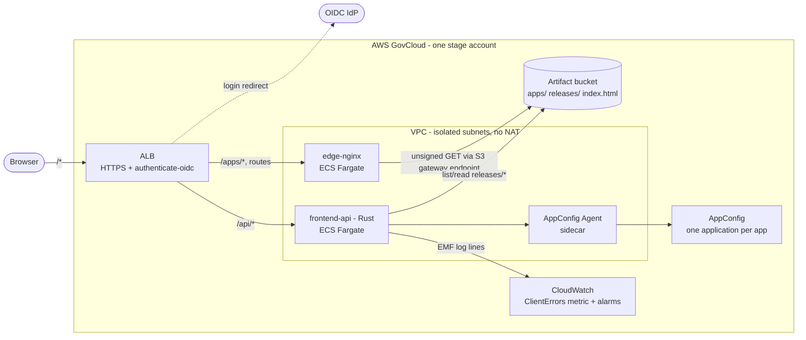
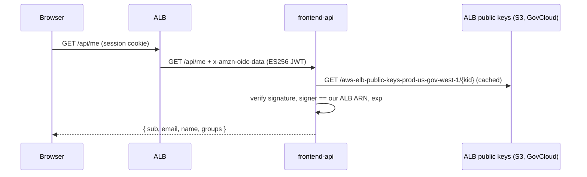
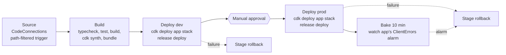

# Architecture

## Goals and constraints

- **GovCloud native.** No CloudFront, so the static origin is nginx on ECS Fargate behind an
  Application Load Balancer.
- **Every request is authenticated**, including JS/CSS: the ALB's `authenticate-oidc` action
  sits in front of everything.
- **Micro-frontends with Module Federation.** A shell composes independently built remotes
  at runtime.
- **Each module ships on its own.** Each module has its own pipeline, deploys on its own, rolls
  back on its own and owns its own feature flags.

## Runtime view



### A page load

1. The browser requests `https://app.example.gov/dashboard`. The ALB finds no session cookie
   and redirects to the IdP. After login it sets the `govcloud-mfe-session` cookie and replays
   the request.
2. The default listener rule forwards to **nginx**, which treats any path outside `/apps/` as a
   client-side route and returns `index.html` from S3 (`Cache-Control: no-cache`). That object
   is a copy of the live shell version's `index.html`.
3. `index.html` references `/apps/shell/<version>/static/js/index.<hash>.js`. Those requests also
   go through the ALB (authenticated) to nginx, which serves them from S3 with a one-year
   `immutable` cache header and keeps a copy in its own disk cache.
4. The shell boots and fetches, in parallel through TanStack Query:
   - `GET /api/modules` returns the live version and `mf-manifest.json` URL of each remote, minus
     any remote whose `moduleEnabled` kill switch is off.
   - `GET /api/feature-flags` returns every app's flags, evaluated for this user by the AppConfig
     Agent.
   - `GET /api/me` and `GET /api/preferences`.
5. The shell builds its routes from the registry. On navigation to `/dashboard/*` it calls
   `registerRemotes()` and `loadRemote('dashboard/App')`. The Module Federation runtime fetches
   `/apps/dashboard/<version>/mf-manifest.json`, then that version's `remoteEntry.js` and chunks,
   all same-origin and all authenticated.
6. The remote renders inside the shell's providers. It uses the shell's QueryClient, router and
   platform SDK because they are shared singletons.

### Authentication and identity



- The browser never holds a token. The ALB session cookie is the only credential.
- The API trusts **only** the signed `x-amzn-oidc-data` header and checks its `signer` against
  its own ALB's ARN. The unsigned `x-amzn-oidc-identity` and `-accesstoken` headers are ignored.
- Target security groups only accept traffic from the ALB's security group, so the header can't
  be injected by anything else in the VPC.
- `/api/*` uses `OnUnauthenticatedRequest: deny`, so an expired session gets a `401` instead of a
  cross-origin redirect that `fetch` can't follow. The SDK's `apiFetch` uses
  `redirect: 'manual'` and reloads the page on 401 or a redirect, which restarts the login.
- **Logout:** `/api/auth/logout` expires the ALB cookie shards and redirects to the IdP's logout
  endpoint. The IdP sends the user back to `/signed-out`, an unauthenticated fixed response on
  the ALB.

## Release model

Every deployable frontend (the shell and each remote) follows the same model:

```
s3://<stage bucket>/
  apps/<app>/<version>/...        immutable, written once by `release publish`
  releases/<app>.json             the live version (mutable pointer, bucket-versioned)
  index.html                      shell only: copy of apps/shell/<live version>/index.html
```

- **Build once, promote everywhere.** A build is compiled against
  `publicPath = /apps/<app>/<version>/`. The same artifact goes to dev and then prod.
- **Deploy = upload + pointer swap.** Uploading never changes what users see. A deploy goes
  live with a single S3 PUT of the pointer.
- **Rollback = pointer swap to an older version.** Old versions are never deleted, so a rollback
  takes seconds and needs no rebuild or cache invalidation.
- **Pinned per page load.** A tab keeps the module versions it booted with. Lazy chunks it needs
  later still exist in S3, and a reload picks up the new version.
- **History is free.** The bucket is versioned, so the object history of `releases/<app>.json`
  is the release history.

See [ADR 0001](adr/0001-runtime-composition-and-pointer-releases.md).

## Delivery view



Each app has **its own pipeline** (`govcloud-mfe-<app>`, defined by the
`GovcloudMfe-Pipeline-<app>` stack), triggered only by changes under its own folder or shared
code. A deploy stage:

1. Deploys the app's own stack (`GovcloudMfe-<stage>-App-<app>`): its AppConfig application and
   flags, its alarm and its release role.
2. Runs `release deploy`, assuming the app's release role. That role can write only
   `apps/<app>/*` and `releases/<app>.json`, so one team's pipeline can't affect another team's
   module.

Rollback is layered (details in the
[runbook](runbooks/deploy-and-rollback.md)):

| Trigger                                | Mechanism                                                   |
| -------------------------------------- | ----------------------------------------------------------- |
| Deploy stage fails                     | CodePipeline `onFailure: ROLLBACK` re-runs the stage with the last good artifact |
| Client errors spike after a prod deploy| The prod stage's Bake action watches the app's alarm and fails if it fires, which triggers the stage rollback |
| A flag change causes client errors     | The AppConfig environment monitor on the same alarm rolls the flag deployment back |
| A human decides                        | `aws codepipeline rollback-stage`, or `pnpm release rollback` (break-glass) |
| A module must disappear right now      | Turn off its `moduleEnabled` flag in AppConfig              |
| A platform container is broken         | ECS deployment circuit breaker rolls the service back      |

The client-error signal comes from the shell: its error boundary around each remote reports
load and render failures to `/api/client-events`. The API turns them into the CloudWatch metric
`GovcloudMfe/Frontend ClientErrors{App=<app>}` using Embedded Metric Format.

## Feature flags

- **One AppConfig application per app** (`govcloud-mfe-<app>`), one environment per stage, one
  `feature-flags` profile. AppConfig allows only one deployment per environment at a time.
  Separate applications mean one team's flag rollout (with its bake time) never blocks or rolls
  back another team's. See [ADR 0003](adr/0003-appconfig-application-per-app.md).
- **Flags as code.** Definitions live in `apps/<app>/feature-flags.json` and ship with the app's
  pipeline. In an incident, operators can still flip a flag in the console.
- **Evaluated server-side** by the AppConfig Agent sidecar, with the user's `userId` and
  `email` passed as context. Multi-variant flags (percentage rollouts, allow-lists) need no
  client logic, and rules never reach the browser.
- In React: `useFeatureFlag('releaseTimeline')` reads the calling module's own flags. The SDK
  knows which module is calling from the `MicroFrontendProvider` the shell wraps around each
  remote.

## Frontend composition

| Concern                  | Decision                                                                 |
| ------------------------ | ------------------------------------------------------------------------ |
| Bundler                  | Rsbuild (Rspack) + `@module-federation/rsbuild-plugin` (MF 2.0, `mf-manifest.json`) |
| Remote discovery         | Runtime: `/api/modules` → `registerRemotes()`. The shell has no static remotes. |
| Contract                 | Each remote exposes `./App`, whose default export takes `{ basePath }` |
| Routing                  | React Router. The shell owns `/<route>/*` and the module owns everything below it, using relative routes |
| Shared singletons        | `react`, `react-dom`, `react-router`, `@tanstack/react-query`, `@govcloud-mfe/platform-sdk`, `@govcloud-mfe/ui`; versions from the pnpm catalog |
| Server state             | One TanStack `QueryClient` owned by the shell. Platform queries are defined once in the SDK, module keys are namespaced by module name |
| Styles                   | Shared design tokens (CSS variables) from `@govcloud-mfe/ui`; CSS Modules inside remotes |
| Failure isolation        | A per-remote error boundary in the shell, which reports to telemetry |

See [ADR 0005](adr/0005-shared-singletons-and-query-cache.md).

## Repository layout

```
apps/
  shell/        host application
  dashboard/    remote
  settings/     remote
packages/
  contracts/    shared types (release record, API DTOs, app descriptor)
  platform-sdk/ runtime SDK: apiFetch, platformQueries, useFeatureFlag, telemetry
  ui/           design tokens + minimal components
  mf-config/    build-time Module Federation "golden path"
services/
  edge-nginx/   authenticated static origin (nginx -> S3)
  frontend-api/ same-origin Rust API (identity, registry, flags, preferences, telemetry)
tools/
  release/      publish / promote / rollback CLI
infra/          AWS CDK: platform stack, per-app stacks, per-app pipelines
dev/releases/   release records used by the frontend-api in local development
docs/           this documentation
```
